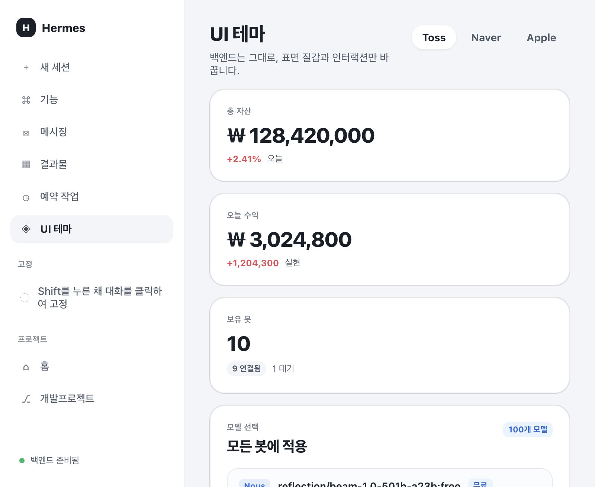

# Hermes UI Collection

Hermes Desktop을 위한 **UI 전용 테마 플러그인**입니다. 백엔드·게이트웨이·모델·기억·스킬은 건드리지 않고, 화면 스타일만 바꿉니다.

## 테마

| 테마 | 설명 |
|---|---|
| **Toss** | 밝은 회색 배경, 파란 포인트, 둥근 카드 |
| **Naver** | 흰 배경, 네이버 그린 포인트 |
| **Apple** | 아이폰처럼 반질반질한 유리 표면, 부드러운 그림자 |

테마는 **설정 → 모양**에서 고르거나, 사이드바의 **UI 테마** 페이지에서 미리 보고 적용할 수 있습니다.

`preview.html`을 열면 실제 앱 없이 세 테마의 질감을 미리 볼 수 있습니다.



## 설치

### 앱에서 설치 (권장)

Hermes Desktop → **기능(Capabilities) → Plugins → Install from Git** 에서 아래 URL을 넣습니다.

```
https://github.com/hushmind3/hermes-ui-collection
```

설치 후 Plugins 목록에서 **Hermes UI Collection** 데스크톱 플러그인을 **켜기** 하면 됩니다. 그다음:

- 설정 → **모양**에서 Toss / Naver / Apple 선택
- 또는 사이드바의 **UI 테마** 페이지에서 미리보고 적용

빌드나 터미널 작업은 필요 없습니다. `plugin.js`는 이미 빌드되어 레포에 포함되어 있습니다.

### 터미널로 설치 (대안)

가장 빠른 이식(플러그인 파일 하나만):

```bash
mkdir -p "$HOME/.hermes/desktop-plugins/hermes-ui-collection" \
  && curl -fsSL https://raw.githubusercontent.com/hushmind3/hermes-ui-collection/main/plugin.js \
     -o "$HOME/.hermes/desktop-plugins/hermes-ui-collection/plugin.js"
```

또는 이 저장소에서:

```bash
./install.sh
```

개발 중에는:

```bash
npm install
npm run build    # src/ → plugin.js
npm run watch    # 저장할 때마다 빌드
```

그다음 Hermes Desktop을 열고 **설정 → 모양**에서 테마를 선택하세요.

## 구조

- `대시보드` 페이지: 봇·그룹·모델 현황과 빠른 작업
- `UI 테마` 페이지: Toss / Naver / Apple 미리보기·적용

```
plugin.js      # 테마 3개 + UI 테마 페이지 + 사이드바 항목
install.sh     # ~/.hermes/desktop-plugins 로 복사
```

## 테마 추가

`plugin.js`의 `OUR_THEMES` 배열에 `DesktopTheme` 객체를 하나 더 넣으면 됩니다.

```js
const MY_THEME = {
  name: 'my-theme',
  label: 'My Theme',
  description: '나만의 테마',
  colors: {
    background: '#...',
    foreground: '#...',
    primary: '#...'
    // ... DesktopThemeColors의 나머지 키
  }
}
```

`colors`는 `background`, `foreground`, `primary`만 있어도 동작하지만, 카드·사이드바·말풍선까지 맞추려면 전체 키를 채우는 것이 좋습니다. 다크 모드는 `darkColors`로 따로 지정할 수 있습니다.

## 참고

- 이 플러그인은 **UI만** 바꿉니다. 모델 호출, 세션, 그룹, 텔레그램, 칸반 동작은 기존 Hermes 그대로입니다.
- `customCSS`는 전역 폴리시용입니다. 내부 클래스명은 업데이트로 바뀔 수 있으므로, 가능하면 테마 토큰과 공개 `data-*` 훅을 사용하세요.
- Hermes Desktop SDK가 바뀌면 플러그인 호환성 수정이 필요할 수 있습니다.

## License

MIT
